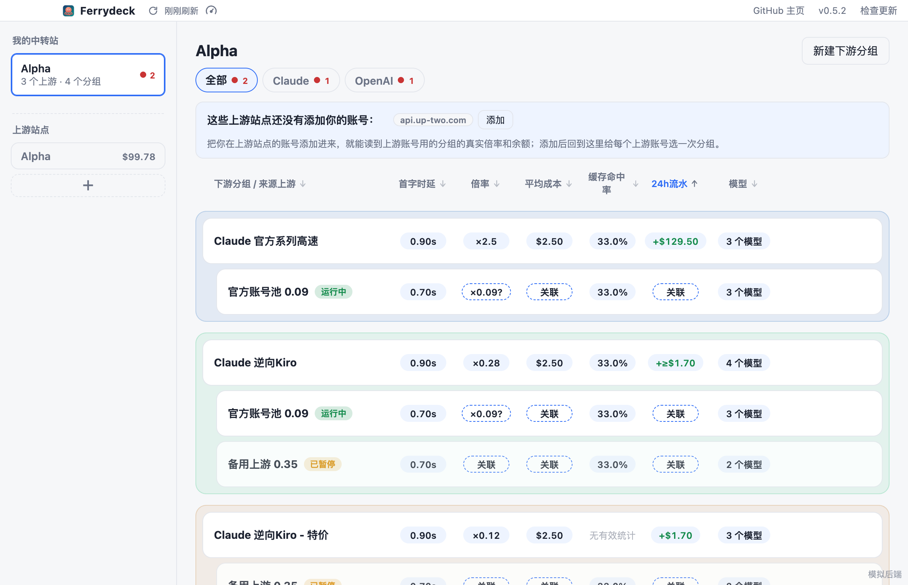
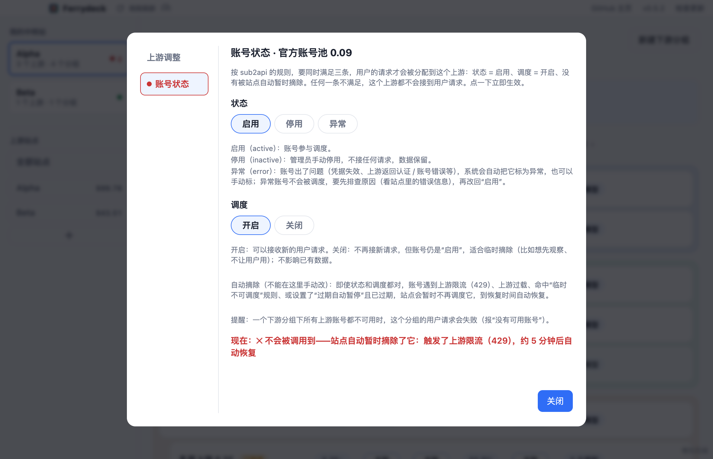
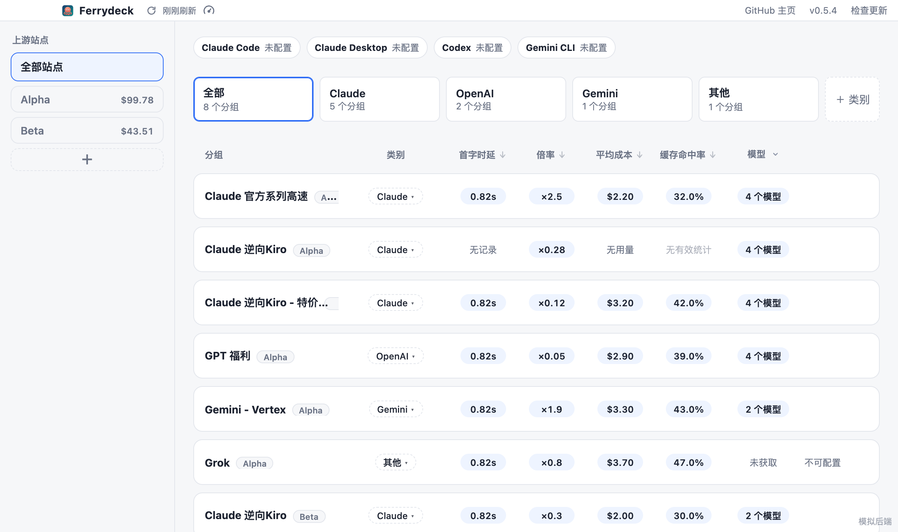
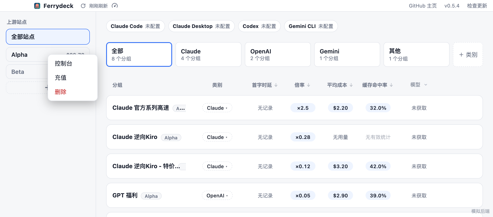

# Ferrydeck

给**中转站站长**和**中转站用户**用的 macOS 桌面工具，支持 **new-api / sub2api** 两类站点。

- **站长**：把你的中转站（下游）和它用的上游站点放在一张表里管理——每个下游分组由哪些上游账号供货、倍率多少、24 小时**赚了多少、付给上游多少**（上游成本读上游站点的真实扣费，不估算）、哪个上游异常或被站点自动摘除，一眼看清；还能直接新建下游分组、给它添加或更换上游账号（自动建 Key、试发一句 "hi"、失败自动回滚）。
- **用户**：把多个中转站的账号和分组聚合在一起，选一个分组，自动写入本机的 **Claude Code / Claude Desktop / Codex / Gemini CLI** 配置，不用再手动申请 Key、改配置文件。

目前支持 **macOS**，Apple 芯片和 Intel 各有一个安装包。



## 功能

### 站长模式：我的中转站

登录站点时勾选「我是该站点管理员」（会先说明，并实际试一下管理接口，普通账号不会被开启）。点开左侧的中转站卡片，右侧是上下游一体视图：

- 每个**下游分组**是一个色块，色块里缩进列出它来源的**上游账号**（sub2api 的账号 / new-api 的渠道）。顶部按客户端分 tab，每个 tab 旁边一个点：有问题的分组是红点加数量，没问题是绿点
- 每行显示首字时延、倍率、平均成本、缓存命中率、**24h流水**、模型：
  - 下游分组的 24h流水显示 `+`，是用户付给你的钱（你的收入）
  - 上游账号显示 `-`，是你付给上游的**真实**成本，读的是你在上游站点登录账号下、关联的那个上游分组的真实扣费记录，**不估算**。所以要先给上游账号关联上游分组：没关联时这两格显示可点的虚线「关联」，点开就是编辑弹窗（若你的账号在该分组里还有别的 Key，也会一起算进去）
  - 默认按 24h流水从高到低排序
- **新建 / 删除下游分组**；**给下游分组添加上游**：选一个你已添加的上游站点和它的分组，应用依次创建（或复用）专用 Key → 读模型 → 发一句 "hi" 试一次 → 在你的站点创建上游账号 / 渠道并绑定（调度默认开启，创建完就参与分配用户请求；需要先观察可以到编辑的「账号状态」里关闭调度）→ 记下关联。任何一步失败都会撤销已做的；Key 只在内存里传递，不显示、不写日志
- **编辑上游账号**（行悬停的编辑图标）：左侧「上游调整」更换它用的上游站点和分组；「账号状态」快速改状态 / 调度。sub2api 有三种状态（启用 / 停用 / 异常）和调度开关，并按它的规则说明：状态、调度、没有被站点自动暂时摘除（上游限流、过载、临时不可调度、过期自动暂停）三条都满足，用户请求才会分配到这个上游；不满足时左侧「账号状态」标红并写明原因和恢复时间
- 同一个上游分组再添加一次会提示共用同一把 Key、会顶掉先到的用户，勾选确认后才能继续
- 编辑下游分组：先填写再看变更清单（倍率会写明涨价 / 降价多少），确认后只提交改过的字段
- 只读取名称、状态、地址主机名等元数据，上游密钥不会显示在界面上，也不写进日志；所有写操作都在诊断日志里留一行（不含密钥和备注内容）



### 用户模式：一键配置客户端

- 添加多个站点，自动识别 new-api / sub2api，用站点的账号密码登录；所有站点的分组合并显示，同名分组并存，可按站点筛选。也支持 `http://` 的自建站（会提示账号密码和 Key 明文传输）
- 点「启用」：自动为该分组创建（或复用）一把名为 `Ferrydeck-<分组名>` 的专用 Key，并写进对应客户端的配置（Claude Code / Claude Desktop / Codex / Gemini CLI）。写入前自动备份，写入后自检，不对就自动回滚，只改自己管的项
- 窗口顶部是客户端 tab，每个 tab 下面一行小字是正在使用的分组；关闭窗口后常驻菜单栏，点图标弹出面板可直接切换分组
- 左侧是**我的中转站**（站长模式才有）和**上游站点**（你登录了账号的站点，名称 + 余额，点击筛选右边的分组）。站点卡片上点**右键**：上游站点是「控制台 / 充值 / 删除」，我的中转站是「控制台 / 删除」
- 每个站点独立显示余额；某个站点登录过期只影响它自己，站点旁有红色感叹号，内容区顶部有带「重试 / 重新登录」的提示





### 分组列表的各列

| 列 | 含义 |
|---|---|
| 客户端 | 这个分组配置到哪些客户端，点开多选下拉修改（关闭时保存）。站点没给分类的显示「未设置」，下拉里默认全不选；全部取消 = 用站点给的默认分类 |
| 首字时延 | 优先用站点用量记录里的**真实首字时延**（近 7 天请求的中位数）；没有才显示本地测速结果 |
| 倍率 | 分组的计费倍率 |
| 平均成本 | 每百万有效 Token 的平均成本 = 近 7 天实付 ÷（输入 + 输出）× 100 万；缓存 Token 单独统计 |
| 缓存命中率 | 缓存读取 ÷（输入 + 缓存创建 + 缓存读取）；近 7 天调用少于 100 次显示「无有效统计」 |
| 模型 | 模型数量，点开右侧抽屉看完整列表 |

- 各列标题都能点击排序；点成本数字打开「成本详情」抽屉（实付总额、缓存、实际倍率、P90 时延、按模型明细、预估价格，只读站点自己的用量记录，不涉及对话内容）
- 没有值的格子会写明原因：**读取失败**（红字，悬停看具体原因）、未读取、无记录、无用量、无输入、未关联……不会只留一个「—」
- 分组行「···」菜单：**sayhi 测试**（选模型说一句 hi，看回复、首字时延和总耗时，失败显示站点原话）和**创建下游**（基于这个分组在你的中转站创建下游分组，或把它加到已有的下游分组下）
- 「测速」对当前列出的分组**逐个**发一条 "hi"（只测一个模型一次，收到第一个字就断开），只在你点的时候才跑，不会自动测速。第一次使用前会说明会做什么
- 按模型筛选分组；备注鼠标放到分组名上才显示；new-api 的分组没有平台分类，在每种客户端下都会显示并标注「该站点未对分组分类」

### 刷新与自动更新

- 顶部的**刷新按钮**一个就够：重新读各站点的账号和余额、分组、模型和成本；正在看「我的中转站」时，也会忽略缓存重读它的上下游列表、关联、用量和真实账单
- 自动刷新很克制：切回窗口时余额和分组最多每 30 秒拉一次（一分钟内拉过用缓存）；成本和用量有 10 分钟缓存；站点限流就停止，剩下的不再请求。后台只做保持登录，**不会在后台刷新分组和模型**，也不会自动测速，不消耗 Token
- 用量日志接口限得很紧的站点（例如 new-api 约 2~3 秒放行一次）会自动排队、等待后重试，不再直接报错
- 应用内自动更新（签名校验），按芯片各取各的更新包

## 隐私与安全

- **密码不会被保存**，只在登录那一刻发给你填写的站点；登录后的刷新凭据存在应用数据目录的 `sessions.json` 里（权限 0600，只有你自己能读）
- 应用只连接**你添加的站点**和**更新地址**，没有统计、没有遥测
- 站点必须是 https（本机地址除外）；开启了人机验证、2FA、或关闭了密码登录的站点暂不支持
- 测速失败等问题可以看诊断日志 `~/.ferrydeck/logs/ferrydeck.log`（不含任何密钥）
- 数据目录被清理软件误删时会明确提示，并可一键恢复站点列表：应用另在 `~/.ferrydeck/` 记了站点的名称和地址（没有任何凭据）
- 为每个分组创建的 Key 会明文写进客户端自己的配置文件（客户端工作所必需），请注意这些文件的访问权限

详见 [SECURITY.md](SECURITY.md)。

## 安装

从 [Releases](https://github.com/taoAIGC/ferrydeck/releases) 页面按自己的电脑下载 dmg：

- **Ferrydeck_aarch64.dmg**：Apple 芯片（M1 / M2 / M3 / M4…，「关于本机」里芯片显示 Apple M 系列）
- **Ferrydeck_x64.dmg**：Intel 芯片的 Mac

或使用安装脚本（自动按本机芯片选包）：

```bash
curl -fsSL https://github.com/taoAIGC/ferrydeck/releases/latest/download/install.sh | sh
```

安装脚本会校验 SHA-256，且用 curl 下载的文件不会被系统打上“隔离”标记，不会弹“未识别的开发者”。
直接下载 dmg 的话，由于没有 Apple 开发者签名，首次打开需要在 系统设置 → 隐私与安全性 里点“仍要打开”。

## 支持的客户端与写入内容

| 客户端 | 文件 | 内容 |
|---|---|---|
| Claude Code | `~/.claude/settings.json` | `env.ANTHROPIC_BASE_URL` / `ANTHROPIC_AUTH_TOKEN` / 可选 `ANTHROPIC_MODEL` |
| Claude Desktop | `~/Library/Application Support/Claude-3p/configLibrary/` | 一个固定 id 的方案文件，在 `_meta.json` 登记并设为当前 |
| Codex | `~/.codex/config.toml`（+ `auth.json`） | `[model_providers.ferrydeck]`，`model_provider` / `model`；Codex 没有任何登录时才写一份 API Key 模式的 `auth.json`，免得打开就停在登录页（已有的 ChatGPT 登录或你自己的 Key 不动，还原时撤销） |
| Gemini CLI | `~/.gemini/.env` + `settings.json` | `GEMINI_API_KEY` / `GOOGLE_GEMINI_BASE_URL` / 可选 `GEMINI_MODEL`，`security.auth.selectedType` |

> Claude Desktop 需要你先在它里面开启开发者模式并进入第三方推理模式，写入的配置才会生效。
> 其写入格式是照已有的可用方案文件确定的，**尚未在真实的 Claude Desktop 里验证过**，欢迎反馈。

写入的共同保证与站点适配细节见 [docs/DESIGN.md](docs/DESIGN.md)。

## 站点适配

| | sub2api | new-api（需 v1.0.0-rc.45 或更新） |
|---|---|---|
| 登录 | 邮箱 + 密码 | 用户名 + 密码，返回约 15 分钟的 Bearer 令牌 + 轮换的刷新 Cookie |
| 分组 | 接口直接给出平台 | 没有平台字段，由公开的 `/api/pricing` 按模型推断 |
| 建 Key | 返回明文 | 列表里是脱敏的，需再取一次明文 |
| 失败形态 | HTTP 状态码 | 常是 HTTP 200 + `success:false` |

其他版本的 new-api 可能接口不同，遇到不支持的情况会给出明确提示。

## 开发

需要 Node.js 20+、Rust（stable）、macOS。

```bash
cd app && npm install
npm run tauri dev        # 开发运行
```

### 测试

```bash
# 界面自动化测试：用本机 Chrome 驱动，使用内置的模拟后端，不碰真实配置
cd app && npm run test:ui

# Rust 测试：全部离线。用本地模拟服务器重现两种站点的各种行为，所有配置写入都在临时目录
cd app/src-tauri && cargo test

# 真实 Tauri 应用里的自检（前后端通信、菜单栏图标、关窗口不退出）
cd app && FERRYDECK_SELFTEST=1 npm run tauri dev
```

可选：用你自己的站点和测试账号做线上端到端测试（默认忽略；配置仍只写临时目录，结束时删除建出的 Key）：

```bash
E2E_SUB2API_URL=https://… E2E_SUB2API_USER=… E2E_SUB2API_PASSWORD=… \
E2E_NEWAPI_URL=https://… E2E_NEWAPI_USER=… E2E_NEWAPI_PASSWORD=… \
E2E_GROUPS="分组A,分组B" \
  cargo test --test e2e_live -- --ignored --nocapture --test-threads=1
```

> 务必设置 `E2E_GROUPS`，否则会一次性为所有分组建 Key，容易被站点限流。
> 浏览器里直接 `npm run dev` 会使用模拟后端，可用 `?s=sites2,expired` 等参数切换场景（见 `app/src/mock.ts` 顶部）。

### 目录

```
app/
  src/                    前端：main.ts 界面，mock.ts 模拟后端
  src-tauri/src/
    sites/                站点适配：sub2api.rs / newapi.rs / http.rs（共用请求层）/ mod.rs
    clients/              各客户端的写入：claude / claude_desktop / codex / gemini / common
    service.rs            “分组 → Key → 写入客户端配置”
    state.rs              已添加的站点及登录会话
    tray.rs               菜单栏菜单内容
    session_store.rs      登录凭据保存到应用数据目录（0600 文件）
  src-tauri/tests/        Rust 测试
  ui-tests/               界面自动化测试
  panel.html + src/panel.ts 菜单栏面板（点菜单栏图标弹出的窗口）
scripts/                  install.sh / release.sh / deploy.sh / render-icons.mjs（图标源文件在 app/src-tauri/icons/source/）
docs/                     设计说明、截图
```

## 构建与发布（自己发布时必读）

**Fork 后发布自己的版本，必须替换以下三样，否则你的用户会从别人的地址收到更新：**

1. 生成你自己的更新签名密钥：`npm run tauri signer generate -- -w ~/.tauri/my-updater.key`，
   把公钥填进 `app/src-tauri/tauri.conf.json` 的 `plugins.updater.pubkey`。**私钥务必备份，丢了就无法再给已安装用户推更新。**
2. 把 `plugins.updater.endpoints` 改成你自己的下载站地址。
3. 复制 `scripts/release.env.example` 为 `.release.env`（已被 `.gitignore` 忽略），填入你的下载站和服务器信息。

```bash
cd app
export TAURI_SIGNING_PRIVATE_KEY=~/.tauri/my-updater.key       # 私钥文件路径或内容
export TAURI_SIGNING_PRIVATE_KEY_PASSWORD=""
npm run tauri build -- --target aarch64-apple-darwin           # Apple 芯片
npm run tauri build -- --target x86_64-apple-darwin            # Intel
cd .. && scripts/release.sh "更新说明"                            # 生成 release/desktop/，并检查更新地址与下载站是否一致
scripts/deploy.sh            # 演练，只显示会上传什么
scripts/deploy.sh --yes      # 真正上传并检查线上
```

发版时同时修改 `tauri.conf.json`、`Cargo.toml`、`package.json` 的 version，且必须比线上的更大。
下载站需要能以静态文件方式提供 `/desktop/*`，Caddy 示例见 `scripts/caddy-desktop.snippet`。

本项目没有 Apple 开发者账号，使用免费的 ad-hoc 签名、不做公证，因此推荐用安装脚本分发。

## 免责声明

本项目是独立的第三方工具，与 Anthropic、OpenAI、Google 及任何中转站运营方均无关联。
“Claude”“Codex”“Gemini”等名称归其各自所有者，这里仅用于说明兼容的软件。
本工具会修改你本机上这些客户端的配置文件；虽然写入前会备份并在出错时回滚，仍建议重要配置自行留一份。
使用任何中转站服务时，请遵守该站点以及上游服务商的使用条款。

## 许可证

[MIT](LICENSE)
